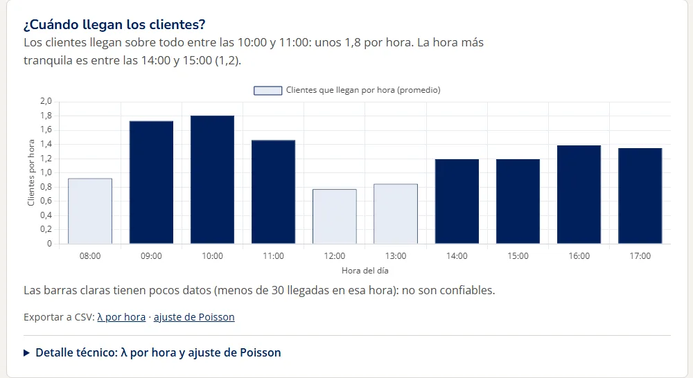
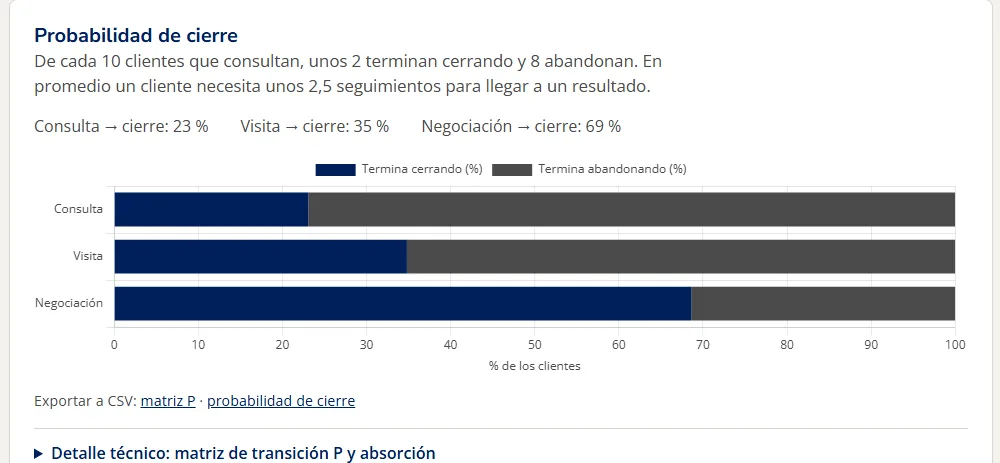

<p align="center">
  
</p>

<p align="center">
  <strong>Sistema de gestión y análisis de ventas y alquiler de inmuebles para una inmobiliaria</strong><br>
  <em>Procesos Estocásticos · Universidad de Córdoba · 2026</em>
</p>

<p align="center">
  <a href="https://github.com/Williamtrix2022/HogarSits/actions/workflows/ci.yml"></a>
  
  
  
</p>

<p align="center">
  <a href="https://hogarsits.onrender.com/"><strong>Sistema en vivo</strong></a> ·
  <a href="https://williamtrix2022.github.io/HogarSits/"><strong>Sitio de presentación</strong></a> ·
  <a href="docs/manual/MANUAL_DE_USUARIO.md">Manual de usuario</a> ·
  <a href="docs/informe/INFORME_FINAL.md">Informe final</a>
</p>

> **Demostración en vivo:** corre en la capa gratuita de Render con **datos simulados**. Si estaba dormida, la primera carga tarda hasta 1 minuto. Es un prototipo académico: no se ha usado con una inmobiliaria real (ver [límites](#-lo-que-no-está-demostrado)).

---

## 📋 Resumen del proyecto

**HogarSits** resuelve la gestión operativa de una inmobiliaria (inmuebles, clientes, visitas y seguimiento) y la combina con herramientas analíticas basadas en **Procesos Estocásticos**. Tiene dos pilares:

1. **Módulo de gestión:** inmuebles con estados, clientes sin duplicados, solicitudes de atención, agenda de visitas **sin cruces** y seguimiento por etapas con historial.
2. **Módulo analítico:** un **proceso de Poisson** (cuándo llegan los clientes), **colas M/M/c** (cuántos asesores hacen falta) y **cadenas de Markov** (qué porcentaje termina cerrando y en cuántos pasos), explicados en lenguaje de negocio.

<p align="center">
  
  &nbsp;
  
</p>
<p align="center"><sub>Panel de Análisis con datos simulados.</sub></p>

---

## 🎯 Objetivos de desarrollo

1. **Gestión operativa:** CRUD completo de inmuebles, clientes, solicitudes y agendamientos, sin duplicidad ni solapamientos de horario. ✅
2. **Modelación de llegadas (Poisson):** estimar λ (llegadas/hora) por franja horaria. ✅ *(validado con datos simulados)*
3. **Teoría de colas (M/M/c):** calcular ρ, Lq y Wq para dimensionar a los asesores. ⚠️ *(las esperas son de orden de magnitud)*
4. **Cadenas de Markov:** construir la matriz P y calcular N = (I − Q)⁻¹, la probabilidad de absorción y el tiempo esperado de cierre. ✅ *(validado con datos simulados)*

---

## 🛠️ Tecnología

| Capa | Qué se usa |
|---|---|
| Lenguaje y framework | Python 3.14 · Django 6.1 |
| Base de datos | PostgreSQL 17 (reglas de integridad en la propia base) |
| Matemática | NumPy y SciPy; funciones puras en `apps/analitica/services/` |
| Interfaz | HTML, CSS y JavaScript propios (sin framework) con la identidad visual de HogarSits · gráficos con Chart.js 4.4.7 |
| Producción | Imagen Docker (`Dockerfile.prod`, gunicorn, WhiteNoise) · demostración en Render (`render.yaml`) |
| Calidad | pytest sobre PostgreSQL real · ruff · GitHub Actions |

---

## 👥 Equipo

| Rol | Integrante | Responsabilidades clave |
| :--- | :--- | :--- |
| **Líder de proyecto** | William Moya Santana | Coordinar entregables, cronograma y coherencia del sistema. |
| **Analista de requerimientos** | Natalia Durango | Entrevistas con la inmobiliaria, levantamiento de casos de uso y documentación. |
| **Desarrollador de software y base de datos** | Camilo Diaz | Modelado entidad-relación, desarrollo backend y frontend e integración de la base de datos. |
| **Modelos estocásticos y pruebas** | Equipo compartido | Modelos de Poisson, colas y Markov, validación de parámetros (λ, μ, P), diseño de pruebas e informe final. |

---

## 🚀 Guía de fases

| Fase | Contenido | Entregable | Estado |
|---|---|---|---|
| 1. Levantamiento | Entrevistas y requerimientos | Documento de requerimientos | ✅ *(la segunda ronda de entrevistas no se hizo)* |
| 2. Diseño | Modelo entidad-relación, wireframes, identidad visual | Diagrama ER y prototipos | ✅ |
| 3. Gestión | Estados de inmuebles, agenda sin cruces | Módulo de gestión funcional | ✅ |
| 4. Analítica | Poisson, colas M/M/c, Markov y panel | Dashboard analítico | ✅ |
| 5. Pruebas y validación | Pruebas, validación de los modelos, informe | Informe de pruebas y validación | ✅ con datos simulados |
| 6. Despliegue y entrega | Imagen de producción, despliegue, sustentación | Sistema desplegado | 🚧 demostración en Render; AWS pendiente |

---

## 📐 Especificación de la cadena de Markov (modelo de ejemplo)

$$\mathbf{P} = \begin{pmatrix}
0.20 & 0.50 & 0.00 & 0.00 & 0.30 \\
0.00 & 0.15 & 0.45 & 0.00 & 0.40 \\
0.00 & 0.00 & 0.20 & 0.55 & 0.25 \\
0.00 & 0.00 & 0.00 & 1.00 & 0.00 \\
0.00 & 0.00 & 0.00 & 0.00 & 1.00
\end{pmatrix}$$

* **Estados transitorios:** Consulta (1), Visita (2), Negociación (3).
* **Estados absorbentes:** Cierre (4), Abandono (5).
* Con esta matriz: **P(cierre desde Consulta) = 22,748 %** y **2,3989 pasos** esperados hasta un resultado.

---

## ✅ Calidad

| Medida | Resultado |
|---|---|
| Pruebas automáticas | **700** contra PostgreSQL real (681 pasan, 5 defectos conocidos declarados como `xfail` estricto y 14 de rendimiento opcionales) |
| Criterios de aceptación con prueba | **31 de 31** (13 historias de usuario) |
| Cobertura de código | **98,2 %** |
| Pantalla más lenta | **532 ms** con 10 262 solicitudes (el límite es 3 s) |

Detalle en el [informe de pruebas](docs/pruebas/INFORME_DE_PRUEBAS.md) y la [validación de los modelos](docs/diseno/VALIDACION_MODELOS.md).

## 🔎 Lo que no está demostrado

- **Datos reales:** todo el análisis se probó con datos simulados; la primera ronda de entrevistas fue de 3 inmobiliarias de Montería y la segunda no se hizo.
- **Las esperas de M/M/c** son de orden de magnitud: la validación mostró que se desvían de la espera simulada porque las visitas sacan a los asesores de la oficina.
- **El historial de etapas no es inmutable** (regla RN-33) y el estado de un inmueble no tiene restricción en la base de datos.
- **AWS:** la imagen de producción se construye y se prueba, pero el despliegue en AWS y las fotos en S3 real no se han verificado.
- **Usabilidad con personas** y concurrencia real: pendientes del piloto.

---

## 🧭 Desarrollo y seguimiento

### Estado de los sprints

| Sprint | Fase | Estado |
|---|---|---|
| 0 Fundaciones | — | ✅ Cerrado |
| 1 Requerimientos | F1 | 🚧 Falta la segunda ronda de entrevistas (#55) |
| 2 Diseño | F2 | ✅ Cerrado |
| 3 Gestión, entrega 1 | F3 | 🚧 Falta verificar las fotos en un bucket real de S3 (#27) |
| 4 Gestión, entrega 2 | F3 | ✅ Cerrado |
| 5 Analítica | F4 | ✅ Cerrado |
| 6 Pruebas, despliegue y entrega | F5 a F6 | 🚧 En curso: informe, manual y demostración listos; despliegue en AWS pendiente (#45, #46, #47) |

### Documentación

Todo está indexado en [`docs/README.md`](docs/README.md). Lo principal:

* **Para presentar:** [sitio de presentación](https://williamtrix2022.github.io/HogarSits/) · [sustentación corta](docs/presentacion/SUSTENTACION_CORTA.md) · [guion completo](docs/presentacion/GUION_SUSTENTACION.md)
* **Para usar el sistema:** [manual de usuario](docs/manual/MANUAL_DE_USUARIO.md)
* **Informe final:** [`docs/informe/INFORME_FINAL.md`](docs/informe/INFORME_FINAL.md)
* **Tablero de sprints:** [`docs/sprints/SPRINTS.md`](docs/sprints/SPRINTS.md) y [milestones en GitHub](https://github.com/Williamtrix2022/HogarSits/milestones)
* **Requerimientos y estado de implementación:** [`docs/requerimientos/REQUERIMIENTOS.md`](docs/requerimientos/REQUERIMIENTOS.md)
* **Diseño:** [modelo de datos](docs/diseno/ER.md) · [wireframes](docs/diseno/WIREFRAMES.md) · [identidad visual](docs/diseno/IDENTIDAD_VISUAL.md)
* **Decisiones de arquitectura:** [`docs/decisiones/`](docs/decisiones/README.md) · **Aprendizaje:** [`docs/aprendizaje/`](docs/aprendizaje/README.md)
* **Despliegue:** [demostración en Render](docs/aws/DESPLIEGUE_RENDER.md) · [imagen Docker y ECR](docs/aws/IMAGEN_DOCKER.md) · [fotos en S3](docs/aws/FOTOS_S3.md)
* **Convenciones para Claude Code:** [`CLAUDE.md`](CLAUDE.md)

### Puesta en marcha local

Requiere Python 3.14, Docker Desktop y Git.

```powershell
copy .env.example .env                  # y edita SECRET_KEY
python -m venv venv
venv\Scripts\Activate.ps1               # PowerShell (en cmd: venv\Scripts\activate)
pip install -r requirements/dev.txt
docker compose up -d db                 # PostgreSQL en el puerto 5433 del equipo
python manage.py migrate
python manage.py createsuperuser        # será tu usuario Administrador
python manage.py seed_datos_simulados   # opcional: datos de prueba (--limpiar los borra)
python manage.py runserver              # http://localhost:8000/ingresar/
```

> El contenedor usa el puerto **5433** porque el 5432 suele estar ocupado por un PostgreSQL instalado en el equipo. Las pruebas necesitan que la base esté encendida (`docker compose up -d db`).

### Calidad y flujo de trabajo

```powershell
ruff check .                                 # estilo
pytest                                       # pruebas (necesitan PostgreSQL)
python manage.py makemigrations --check --dry-run
```

`main` está protegida: todo cambio entra por **Pull Request** con el CI en verde, una rama por historia (`feature/<n>-descripcion`) y `Closes #n` en la descripción.

### Estructura

* `config/`: configuración por entorno (`base`, `dev`, `prod`)
* `apps/cuentas` (acceso, roles, menú) · `apps/comun` (utilidades compartidas) · `apps/inmuebles` · `apps/clientes` · `apps/seguimiento` · `apps/agenda` · `apps/analitica` (con `services/` para Poisson, colas y Markov)
* `templates/` y `static/`: interfaz (componentes en `templates/componentes/`; guía viva en `/administracion/componentes/`)
* `site/`: sitio de presentación (HTML estático, publicado con GitHub Pages)
* `docs/` documentación · `tests/` pruebas · `Dockerfile.prod` y `render.yaml`: despliegue
