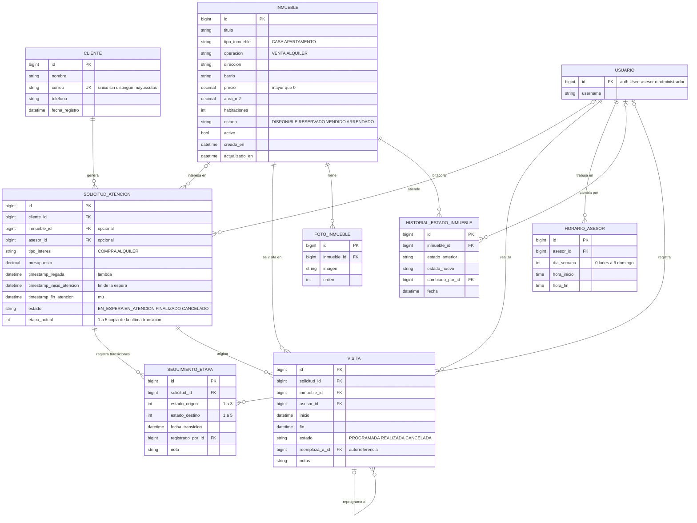
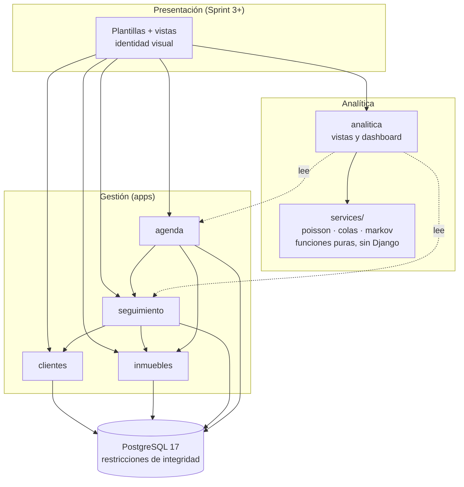

# HogarSits — Modelo de datos y diagrama ER

**Versión:** 1.0 · **Fecha:** 2026-11-08 · **Sprint:** 2 · **Issues:** #19, #22 · **Decisiones:** [`ADR-003`](../decisiones/ADR-003-modelo-de-datos.md)
**Implementación:** `apps/*/models.py` (migraciones aplicadas; 28 tests de integridad sobre PostgreSQL).

Principios de diseño: (1) **la base de datos es la última línea de defensa**: las reglas críticas viven como restricciones, no solo en formularios; (2) **el modelo debe alimentar a los modelos estocásticos** sin transformaciones heroicas; (3) **el historial no se destruye** (el análisis depende de él); (4) **simple para 2–5 asesores y 30–80 inmuebles**, sin sobreingeniería.

## 1. Diagrama entidad-relación

## 2. Decisiones de arquitectura (resumen; detalle en ADR-003)

| # | Decisión | Por qué |
|---|---|---|
| 1 | **Cruces de agenda prohibidos por la BD** con `ExclusionConstraint` de PostgreSQL (`tstzrange [inicio, fin)` + igualdad de asesor o inmueble, ignorando visitas canceladas). | Una validación en el formulario no protege de dos pestañas, dos asesores o un script. La BD serializa la carrera y es la única garantía real (RNF-03). Requiere la extensión `btree_gist`. |
| 2 | Rangos semiabiertos `[inicio, fin)`. | Una visita que termina a las 10:00 no choca con la que empieza a las 10:00. |
| 3 | `timestamp_llegada` con `default=timezone.now`, **no** `auto_now_add`. | `auto_now_add` ignora el valor que se le pase: el generador de datos simulados y la carga de históricos no podrían fijar la hora. La UI no lo expone, así que RN-11 se mantiene. |
| 4 | Tiempos validados por `CHECK`: `llegada ≤ inicio ≤ fin` y estado coherente con los tiempos. | Datos inconsistentes contaminan λ y μ en silencio. |
| 5 | `on_delete=PROTECT` hacia cliente, inmueble, asesor y solicitud; los inmuebles se **desactivan**. | Borrar en cascada destruiría el historial que alimenta los modelos estocásticos. |
| 6 | `etapa_actual` **denormalizada** en la solicitud; `SeguimientoEtapa` es la fuente de verdad. | Los listados necesitan filtrar por etapa sin un `JOIN` a la última transición. Un servicio las mantiene sincronizadas en una transacción (#32). |
| 7 | `CHECK`: no se sale de Cierre (4) ni Abandono (5) (RN-31). **No** se exige `origen ≠ destino`. | La matriz P del README tiene Consulta→Consulta = 0,20. **ADR-002** (ronda 2) decidirá cómo se registra una autotransición; no se cierra esa puerta antes de tiempo. |
| 8 | Asesor = `AUTH_USER_MODEL` + `HorarioAsesor` (turnos). Roles con `Group` de Django (Sprint 3). | Evita un modelo de perfil duplicado. `c` efectivo = asesores con turno en la franja − asesores con una visita en esa franja. |
| 9 | Reprogramar = cancelar y crear otra visita con `reemplaza_a`. | Conserva el historial y mantiene simple la restricción de cruces. |
| 10 | Correo único **sin distinguir mayúsculas** (`UNIQUE (lower(correo))`) y normalizado a minúsculas. | `Ana@x.com` y `ana@x.com` son la misma persona (RN-10). El teléfono se indexa pero **no** es único (varias personas comparten número). |
| 11 | `CHECK` de coherencia estado/operación: un alquiler no puede estar *Vendido* ni una venta *Arrendada*. | Cierra por construcción un error que la encuesta reporta (ofrecer inmuebles ya cerrados). |
| 12 | **Un solo inquilino de datos** (una inmobiliaria). Sin `inmobiliaria_id` en cada tabla. | Multi-inmobiliaria está fuera del alcance (REQUERIMIENTOS §1). Añadirlo después es una migración mecánica; hacerlo ahora complicaría todo sin valor para el piloto. |

## 3. Invariantes: quién las garantiza

| Regla | Capa | Mecanismo |
|---|---|---|
| RN-01 / RN-02 sin cruces de asesor / inmueble | **BD** | `ExclusionConstraint` ×2 (+ `clean()` para mensajes amables, #30) |
| RN-04 canceladas liberan horario | BD | `condition=~Q(estado="CANCELADA")` |
| RN-10 correo único | BD | `UniqueConstraint(Lower("correo"))` |
| RN-20 llegada ≤ inicio ≤ fin; estado coherente | BD | 3 `CHECK` en `SolicitudAtencion` |
| RN-31 Cierre/Abandono absorbentes | BD | `CHECK origen ∉ {4,5}` |
| Estado coherente con operación | BD | `CHECK` en `Inmueble` |
| RN-03 no ofrecer inmuebles vendidos/arrendados | Servicio | Depende de otra tabla; se valida en la capa de servicio (#31) |
| RN-30 transiciones válidas entre etapas | Servicio | Tabla de transiciones permitidas (#32); depende de ADR-002 |
| RN-11 hora de llegada no editable | Formulario / admin | `editable=False` |

## 4. Cómo alimenta el modelo a la analítica

| Modelo | Dato | Consulta base |
|---|---|---|
| Poisson (λ) | `timestamp_llegada` | contar llegadas por franja (`date_trunc('hour', timestamp_llegada AT TIME ZONE 'America/Bogota')`) y día de la semana — índice `solicitud_llegada_idx` |
| Colas (μ) | `fin − inicio` de solicitudes `FINALIZADO` | media del tiempo de servicio; las `CANCELADO` se excluyen (RN-22) |
| Colas (espera real) | `inicio − llegada` | contraste con Wq del modelo |
| Colas (c) | `HorarioAsesor` − `Visita` en la franja | asesores disponibles; las visitas de 30–120 min sacan al asesor de la oficina (hallazgo de la ronda 1) |
| Markov (P) | `SeguimientoEtapa(origen, destino)` | tabla de conteos por par — índice `seguim_transicion_idx` |
| Indicadores por asesor | `SolicitudAtencion.asesor`, `Visita.asesor` | agregados por asesor y rango — índices `solicitud_asesor_estado_idx`, `visita_asesor_inicio_idx` |

## 5. Vista lógica de módulos (dirección de las dependencias)

Reglas: las flechas no se invierten (`inmuebles` y `clientes` no conocen a `seguimiento` ni a `agenda`); `analitica/services` **no importa Django** (se testea contra los ejemplos de la Propuesta); la analítica solo **lee** de los datos de gestión.

## 6. Riesgos y puntos abiertos

| Riesgo / pendiente | Mitigación |
|---|---|
| `ExclusionConstraint` solo existe en PostgreSQL | El proyecto ya es PostgreSQL en local, CI y AWS (ADR-001). No usar SQLite. En RDS, `btree_gist` es una extensión permitida; **verificar al desplegar** (Sprint 6). |
| Si I02 confirma visitas **grupales** (varios clientes, mismo inmueble y hora), el cruce por inmueble sobra | Una migración que elimine `visita_sin_cruce_inmueble`; está aislada por nombre. Pregunta E5 en la ronda 2 (#55). |
| Autotransiciones de Markov (ADR-002, #20) | `SeguimientoEtapa` admite `origen = destino`; la decisión puede ser registrar un evento "sin avance" o una observación periódica sin cambiar el esquema. |
| `etapa_actual` puede desincronizarse de `SeguimientoEtapa` | Solo se modifica mediante un servicio transaccional; prueba de consistencia en #32. |
| Fotos: `ImageField` guarda en disco local | En Sprint 3/6 se cambia a S3 con `django-storages` sin tocar el modelo (#27). |
| No hay canal de llegada (presencial / teléfono / WhatsApp) | Se añade si la ronda 2 muestra que λ difiere por canal (E6). |

## 7. Cambios respecto al modelo del Sprint 0
`Inmueble.tipo` → `operacion` (renombrado con migración, sin pérdida de datos) · nuevos `tipo_inmueble`, `barrio`, `area_m2`, `habitaciones`, `descripcion`, `activo`, fechas · `FotoInmueble` y `HistorialEstadoInmueble` · `SolicitudAtencion`: `tipo_interes`, `presupuesto`, `etapa_actual`, `PROTECT` y restricciones de tiempo · `SeguimientoEtapa`: `registrado_por`, `nota`, restricciones · **nuevos** `Visita` y `HorarioAsesor` · `Cliente.correo` único sin distinguir mayúsculas.
