# HogarSits — Wireframes y flujos de navegación

**Versión:** 0.1 · **Fecha:** 2026-11-08 · **Sprint:** 2 · **Issue:** #21
**Insumos:** [`REQUERIMIENTOS.md`](../requerimientos/REQUERIMIENTOS.md) v0.2 (HU-01 a HU-13), [`CASOS_DE_USO.md`](../requerimientos/CASOS_DE_USO.md), [`IDENTIDAD_VISUAL.md`](IDENTIDAD_VISUAL.md), [`RESULTADOS_ENCUESTA.md`](../investigacion/resultados/RESULTADOS_ENCUESTA.md).

Son **bocetos de baja fidelidad** hechos con Mermaid (se ven en GitHub y se versionan con el código). Muestran **estructura, contenido y acciones**, no el aspecto final: colores, tipografía y espaciado se definen al implementar con la guía de identidad visual (#25).

## 1. Principios de diseño (salen de la encuesta)

| Hallazgo | Decisión de interfaz |
|---|---|
| 3/3 han perdido solicitudes por falta de seguimiento | La **pantalla de inicio es «a quién contactar hoy»**, no un menú. |
| El inventario es lo más valioso; la agenda, lo segundo | «Inmuebles» y «Agenda» son accesos de primer nivel y se pueden usar sin pasar por Análisis. |
| La analítica fue lo menos valorado | Cada cifra de **Análisis** lleva una frase en lenguaje de negocio (RF-59); nada de «λ» o «P» sin explicación. |
| «Fácil de usar, sin conocimientos técnicos» | Un objetivo por pantalla, formularios cortos, mensajes de error que dicen **qué hacer**. |
| Escala pequeña (2–5 asesores, 27–80 inmuebles) | Listas con filtros simples; sin paginación compleja ni tableros recargados. |
| El estado no se comunica solo con color | Chips con **punto + texto** (Disponible · Reservado · Vendido/Arrendado). |

**Convenciones de los bocetos:** bloque azul oscuro = marca / acción primaria · bloque beige = aviso · bloque blanco = contenido · borde rojo = error. Los textos de ejemplo son ficticios.

## 2. Estructura general (todas las pantallas)

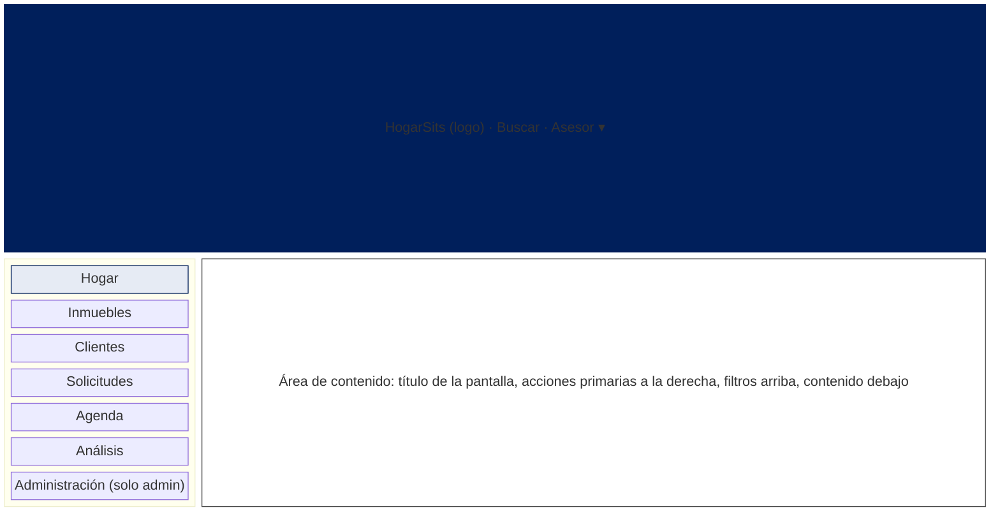
- Menú lateral fijo en escritorio; en teléfono se colapsa en un botón. El ítem activo se resalta.
- El asesor **no ve** «Administración» ni los indicadores de otros asesores (RF-03, HU-13).

## 3. Mapa del sitio y roles

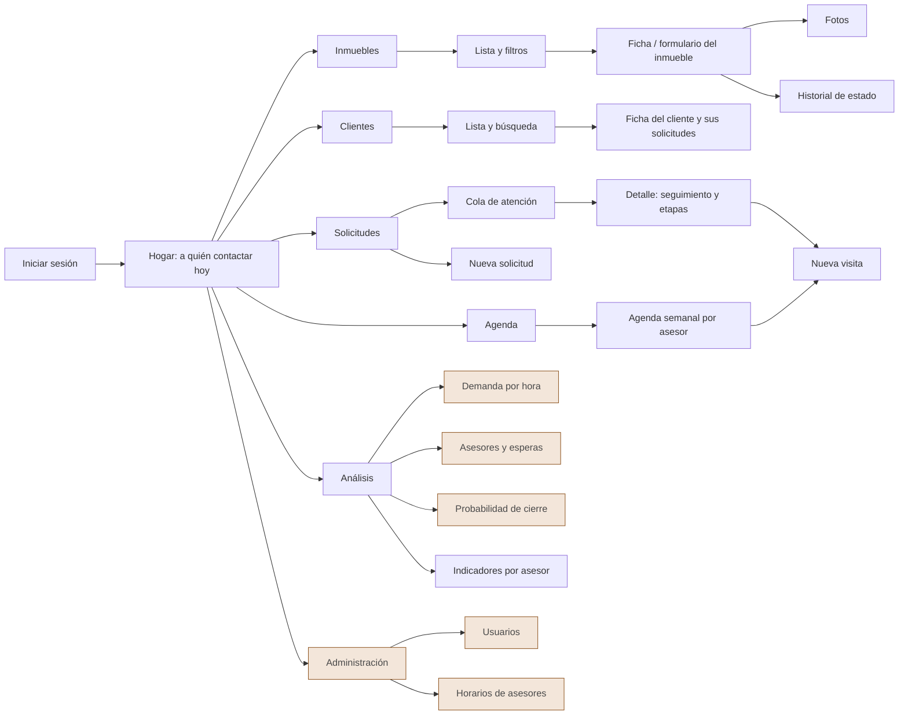

| Zona | Administrador | Asesor |
|---|---|---|
| Hogar, Inmuebles, Clientes, Solicitudes, Agenda | ✅ | ✅ (Agenda: la propia y la de consulta) |
| Análisis: demanda, asesores, probabilidad de cierre | ✅ | — |
| Análisis: indicadores por asesor | todos | solo los propios |
| Administración (usuarios, horarios) | ✅ | — |

## 4. Flujos clave

### 4.1 Del cliente que llega a la solicitud atendida (CU-04, CU-05, CU-06)
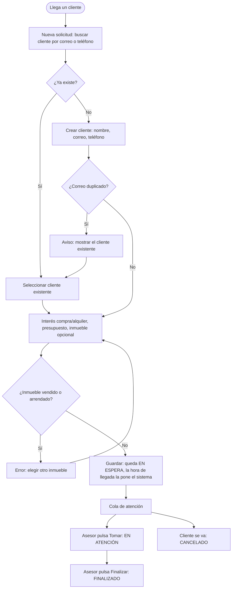

### 4.2 Agendar una visita sin cruces (CU-07)
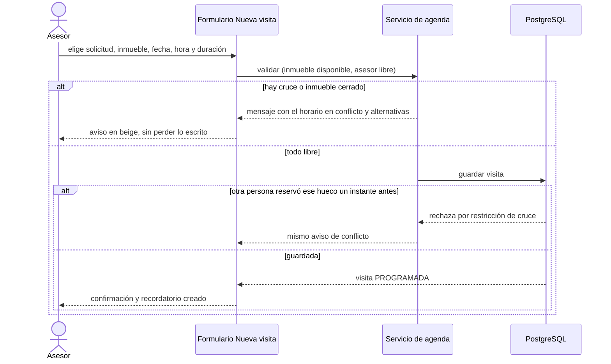

### 4.3 Cambio de etapa (CU-08)
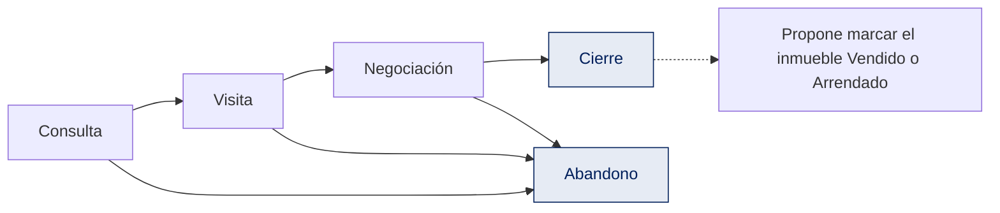
Solo se ofrecen en pantalla las etapas permitidas desde la actual; Cierre y Abandono no admiten más cambios. *(Cómo se registra «seguir en la misma etapa» depende de ADR-002, pendiente de la ronda 2.)*

## 5. Pantallas

### W1 · Inicio de sesión — RF-01

Acciones: *Entrar*. Sin sesión no se accede a ninguna otra pantalla. El mensaje de error no revela si falló el usuario o la contraseña.

### W2 · Hogar: a quién contactar hoy — HU-12, RF-25, RF-26, RF-35
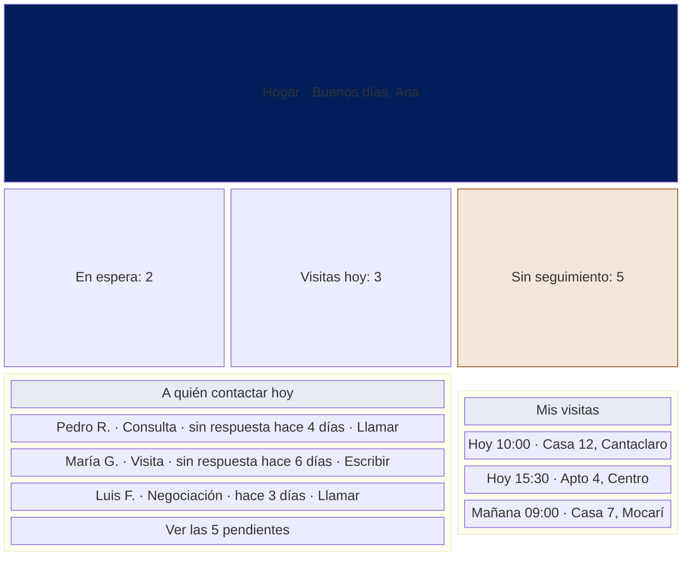
Datos: solicitudes del asesor con seguimiento pendiente ordenadas por antigüedad; marca beige las que superan N días (N configurable, pendiente de E7). Acciones: abrir la solicitud, registrar el contacto. Vacío: «Todo al día. No tiene seguimientos pendientes.» El administrador ve el total del equipo y puede filtrar por asesor.

### W3 · Inmuebles: lista y filtros — HU-01, RF-14
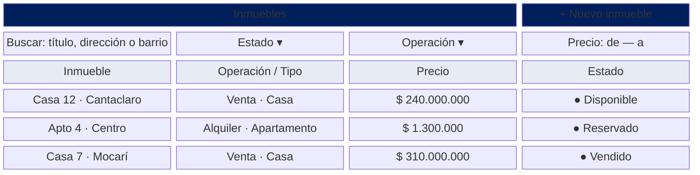
Chips de estado: punto verde (Disponible), cobre (Reservado), gris (Vendido/Arrendado), siempre con texto. Los inmuebles desactivados no aparecen salvo con el filtro «Incluir inactivos». Vacío: «No hay inmuebles con esos filtros. Quite algún filtro o cree uno nuevo.»

### W4 · Ficha / formulario de inmueble — RF-10, RF-11, RF-12, RF-13
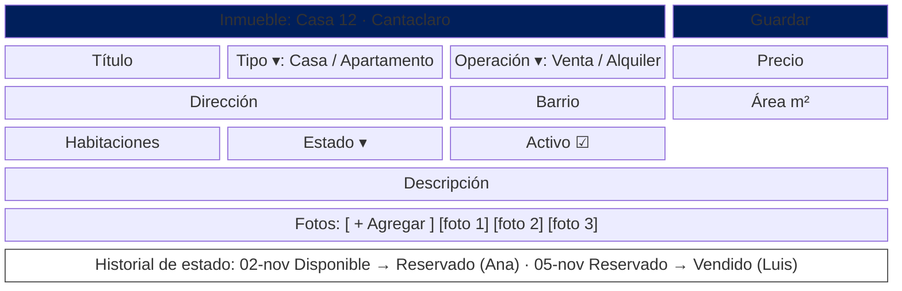
Reglas visibles: un alquiler no puede quedar «Vendido» ni una venta «Arrendada» (el estado solo ofrece opciones coherentes); el precio debe ser mayor que 0; «Desactivar» reemplaza a «Eliminar» (el historial se conserva). Cada cambio de estado queda en el historial con usuario y fecha.

### W5 · Nueva solicitud (con búsqueda y control de duplicados) — HU-03, HU-04
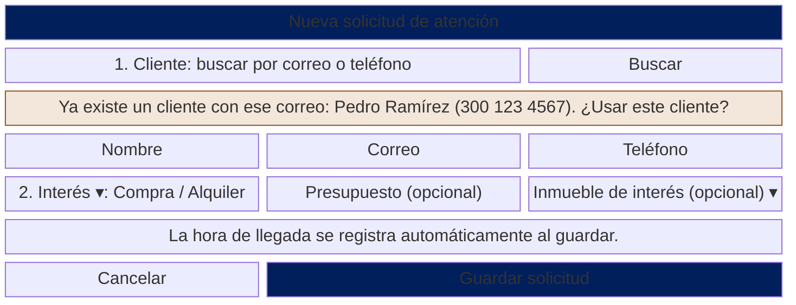
El aviso beige aparece al detectar un correo existente (sin distinguir mayúsculas). El inmueble solo lista los **no vendidos/arrendados**. Al guardar: solicitud *En espera* y etapa *Consulta*.

### W6 · Cola de atención — HU-04
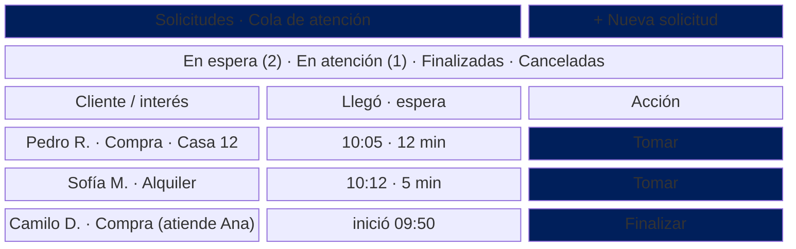
*Tomar* asigna el asesor y guarda la hora de inicio; *Finalizar* guarda la hora de fin (debe ser posterior al inicio). La espera se calcula sola (inicio − llegada) y alimenta el análisis de colas.

### W7 · Agenda semanal por asesor — RF-34
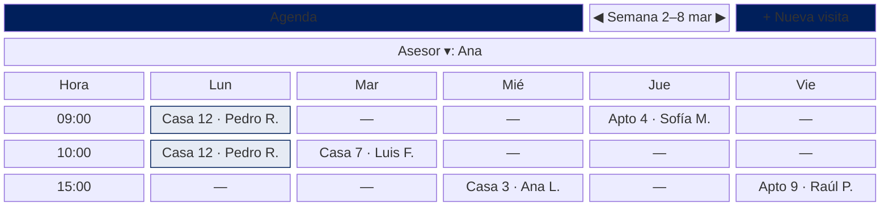
Muestra también los turnos del asesor (horas fuera de turno en gris). Las visitas canceladas no ocupan casilla. Clic en una visita: ver, reprogramar, cancelar o marcar como realizada.

### W8 · Nueva visita con aviso de cruce — HU-05, RN-01, RN-02
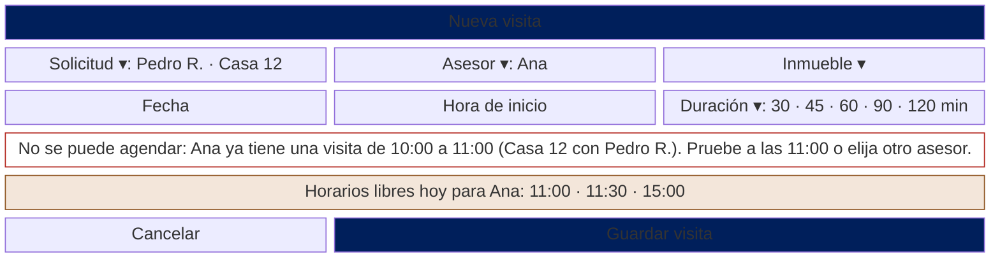
El mensaje dice **qué choca y qué hacer**; conserva lo ya escrito. Una visita que empieza justo cuando otra termina **sí** se permite. Si la ronda 2 confirma visitas grupales, el aviso por cruce de *inmueble* se relaja.

### W9 · Detalle de solicitud: seguimiento y etapas — HU-06, CU-08
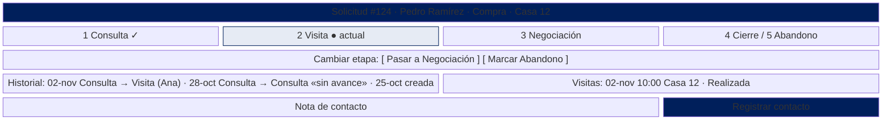
Solo se ofrecen las etapas permitidas desde la actual. En Cierre/Abandono el panel queda en solo lectura. Al elegir Cierre se pregunta: «¿Marcar la Casa 12 como Vendida?». *(La fila «sin avance» es provisional hasta ADR-002.)*

### W10 · Análisis: demanda por hora — HU-07, RF-50, RF-59
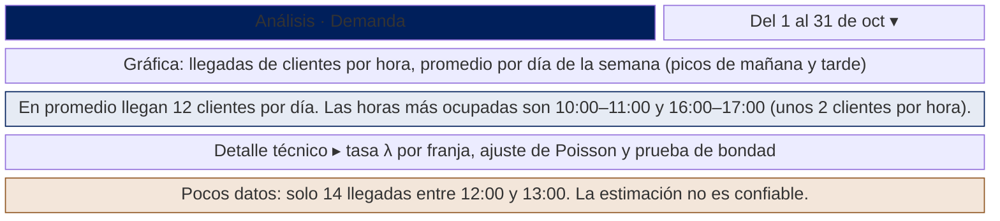
La frase en lenguaje de negocio va **arriba**; la técnica (λ, P(X = k)) en un panel plegable. La advertencia aparece cuando hay menos observaciones que el mínimo (RN-40). Solo administrador.

### W11 · Análisis: asesores y esperas — HU-08, RF-51 a RF-53, RF-59
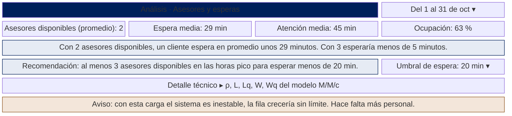
«Asesores disponibles» descuenta a quienes están en visita (el hallazgo de la ronda 1). El aviso de inestabilidad (ρ ≥ 1) sustituye a las cifras L, Lq, W, Wq. Solo administrador.

### W12 · Análisis: probabilidad de cierre — HU-09, RF-54, RF-55, RF-59
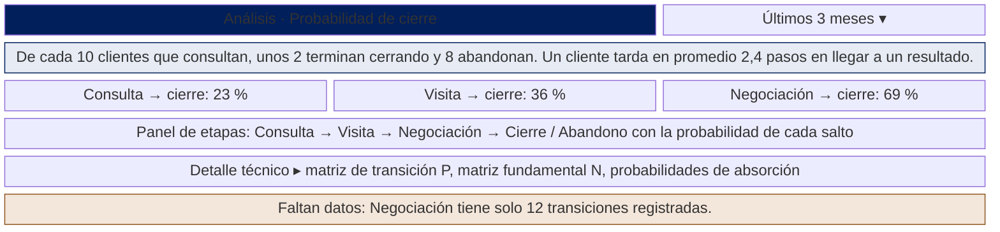
Los valores de la figura son ilustrativos y coinciden con la matriz de ejemplo del README (23 %, 36 % y 69 %; 2,4 pasos desde Consulta). En W11, las cifras de espera (29 min con 2 asesores, unos 4 con 3) salen del modelo M/M/c con λ = 20 clientes/12 h y μ = 1 cliente/45 min. El panel de etapas reutiliza el componente visual de W9.

### W13 · Indicadores por asesor — HU-13, RF-62
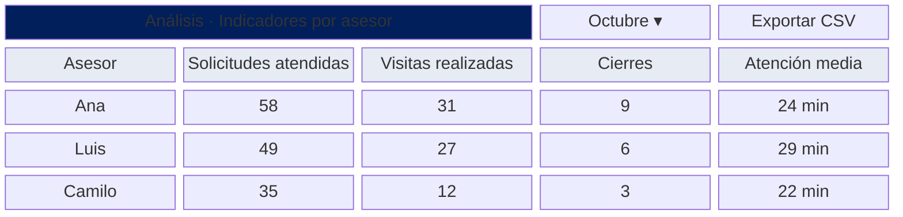
El asesor ve solo su fila. Cifras ilustrativas. Pedida expresamente por una de las inmobiliarias entrevistadas.

### W14 · Administración: usuarios y horarios — RF-02, RF-36
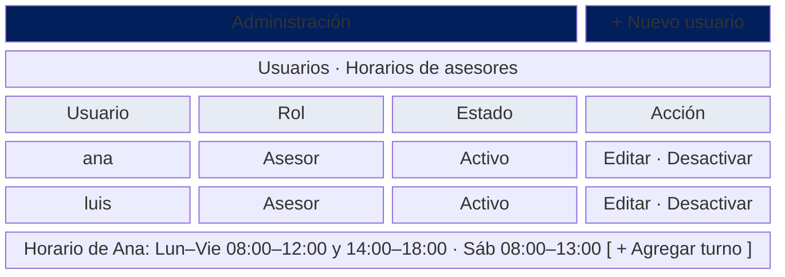
Los usuarios se **desactivan**, no se borran (tienen historial). El horario semanal define cuántos asesores hay disponibles por franja (c) para el análisis de colas; el turno debe terminar después de empezar y no repetirse.

## 6. Estados y mensajes comunes

| Situación | Cómo se muestra |
|---|---|
| Lista vacía | Texto que explica y ofrece la acción siguiente («No hay… Cree uno nuevo»). |
| Error de validación | Borde rojo `#B3261E` en el campo + mensaje debajo que dice **cómo corregir**. |
| Aviso (cruce, duplicado, pocos datos) | Bloque beige con borde cobre oscuro; no bloquea el trabajo salvo que la regla lo exija. |
| Acción destructiva (desactivar, cancelar visita) | Confirmación en una frase; nunca borrado definitivo. |
| Cargando | Esqueleto gris en la zona de contenido, no pantalla en blanco. |
| Sin permiso | «Esta sección es solo para administradores» con enlace a Hogar. |

## 7. Trazabilidad

| Pantalla | Historias | Requerimientos | Sprint | Issue |
|---|---|---|---|---|
| W1 | HU-11 | RF-01 | 3 | #24 |
| W2 | HU-12 | RF-25, 26, 35 | 4 | #33, #52 |
| W3, W4 | HU-01, HU-02 | RF-10 a 15 | 3–4 | #26, #27, #31 |
| W5, W6 | HU-03, HU-04 | RF-20 a 24 | 3 | #28, #29 |
| W7, W8 | HU-05 | RF-30 a 34 | 4 | #30 |
| W9 | HU-06 | RF-40 a 43 | 4 | #32 |
| W10 a W12 | HU-07 a HU-09 | RF-50 a 59 | 5 | #35 a #38 |
| W13 | HU-13 | RF-62 | 5 | #54 |
| W14 | HU-11 | RF-02, RF-36 | 3–4 | #24, #53 |

## 8. Pendientes y puntos a validar
- [ ] **Color de error**: la paleta de marca no define uno; se propone `#B3261E` (contraste 6,5:1 sobre blanco). Añadir a `IDENTIDAD_VISUAL.md` al aprobarlo.
- [ ] Validar estos bocetos con **I02** (candidata a piloto) en la segunda ronda (#55): ¿«a quién contactar hoy» es lo primero que quiere ver? ¿Cuántos días sin respuesta marcan una solicitud (N)?
- [ ] Definir cómo se muestra en W9 la autotransición (depende de ADR-002, #20).
- [ ] Alta fidelidad con la marca al implementar (#25); revisar accesibilidad (contraste, foco con teclado, tamaño táctil ≥ 44 px).
- [ ] Decidir si «Clientes» necesita pantalla propia más allá de la búsqueda de W5 (ficha del cliente con sus solicitudes).
