# HogarSits — Manual de usuario

Para **asesores** y **administradores** de una inmobiliaria. No necesita saber de estadística: cada pantalla explica sus cifras con frases.

> **Sobre las imágenes.** Todas las capturas usan **datos simulados** (clientes «Simulado 0001», inmuebles «[SIM]», asesores «Asesor 1»). No son de ninguna inmobiliaria real. En su sistema verá sus propios datos.

## Contenido
1. [Antes de empezar](#1-antes-de-empezar)
2. [La pantalla de inicio](#2-la-pantalla-de-inicio)
3. [Inmuebles](#3-inmuebles)
4. [Clientes](#4-clientes)
5. [Atender a un cliente: de la llegada al cierre](#5-atender-a-un-cliente-de-la-llegada-al-cierre)
6. [Agenda de visitas](#6-agenda-de-visitas)
7. [Solo administradores](#7-solo-administradores)
8. [Mensajes frecuentes y qué hacer](#8-mensajes-frecuentes-y-qué-hacer)
9. [Lo que HogarSits no hace (todavía)](#9-lo-que-hogarsits-no-hace-todavía)

---

## 1. Antes de empezar

### Entrar y salir
Escriba el usuario y la contraseña que le dio el administrador y pulse **Entrar**. El botón **Mostrar** deja ver la contraseña mientras la escribe. Para salir use **Salir**, arriba a la derecha.

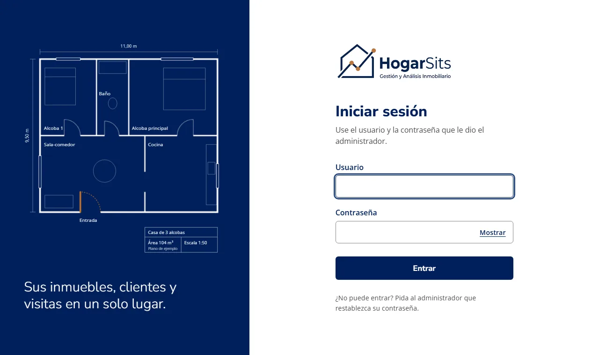

- Con **5 intentos fallidos** seguidos desde el mismo equipo, el acceso se bloquea **15 minutos**. Si olvidó la contraseña, pida al administrador que la restablezca (esto también levanta el bloqueo).
- Cambie su contraseña desde **Mi contraseña**.

### Dos roles
| | Asesor | Administrador |
|---|---|---|
| Inmuebles, clientes, solicitudes, agenda | Sí | Sí |
| Ver sus propios indicadores | Sí (en el inicio) | Sí, y los de todo el equipo |
| Usuarios, horarios, asesores disponibles | No | Sí |
| Análisis (demanda, esperas, cierre) y exportar a CSV | No | Sí |

Si un asesor abre una pantalla de administración recibe un aviso de acceso denegado.

### El menú
A la izquierda: **Hogar** (inicio), **Inmuebles**, **Clientes**, **Solicitudes**, **Agenda**; el administrador ve además **Análisis** y **Administración**.

---

## 2. La pantalla de inicio

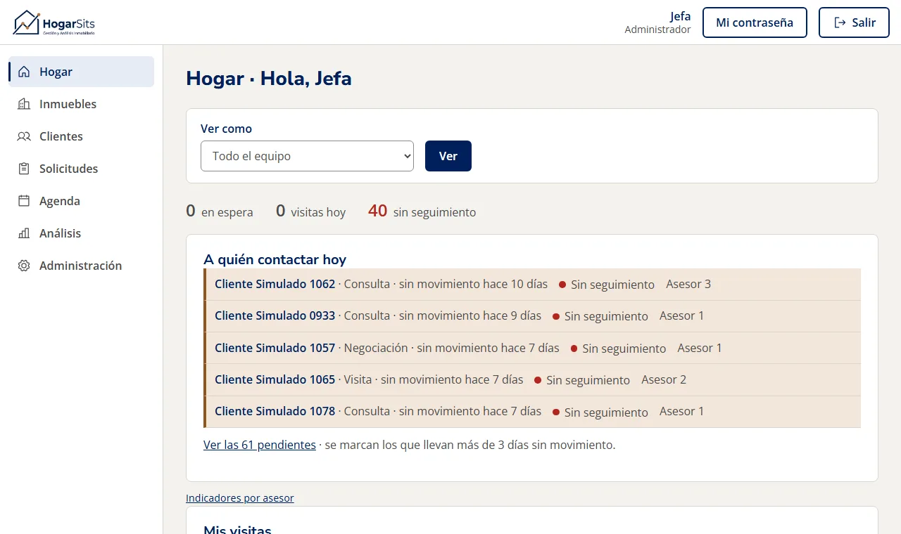

- **A quién contactar hoy:** las solicitudes abiertas que llevan **más de 3 días sin movimiento** aparecen resaltadas con la marca «Sin seguimiento» y el asesor responsable. Es la lista para no dejar clientes olvidados.
- Arriba: cuántos clientes están **en espera**, cuántas **visitas hay hoy** y cuántas solicitudes están **sin seguimiento**.
- **Mis visitas:** las de hoy y mañana.
- El administrador puede elegir **Ver como** un asesor o todo el equipo.

---

## 3. Inmuebles

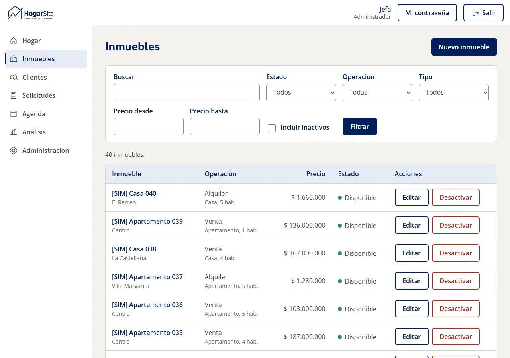

### Buscar y filtrar
Use **Buscar** (por título, barrio o dirección), **Estado**, **Operación**, **Tipo** y rango de **Precio**. Por defecto no se muestran los inmuebles **inactivos**; marque **Incluir inactivos** para verlos.

### Registrar un inmueble
1. Pulse **Nuevo inmueble**.
2. Complete título, tipo, operación (venta o alquiler), dirección, barrio, precio, área, habitaciones y estado.
3. Pulse guardar. El precio se escribe en pesos, por ejemplo `240.000.000`.

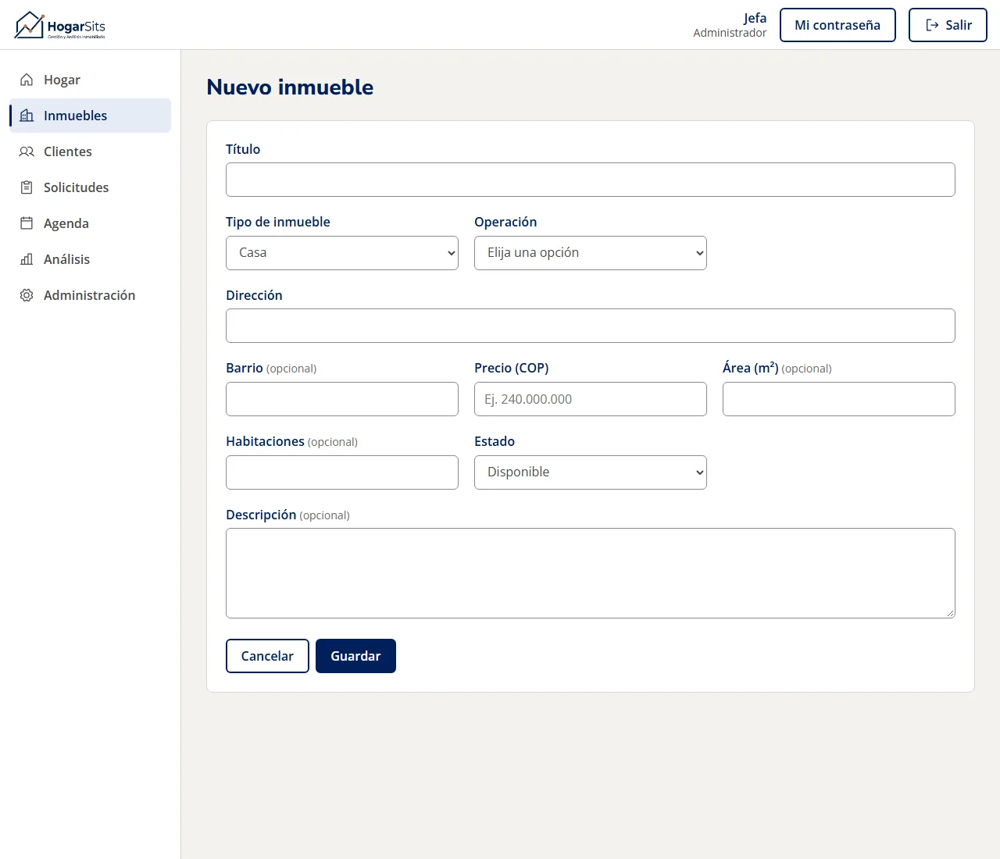

### Estados
**Disponible → Reservado → Vendido / Arrendado.** Un inmueble **Vendido** o **Arrendado** ya no se puede ofrecer: el sistema no deja crear solicitudes ni visitas sobre él.

### Desactivar
**Desactivar** oculta el inmueble de las listas sin borrar su historia. Puede reactivarlo cuando quiera.

### Fotos
Desde la edición del inmueble puede subir fotos. *Nota:* el almacenamiento de fotos en la nube (S3) está programado y probado en local, pero **no se ha verificado con un bucket real**.

---

## 4. Clientes

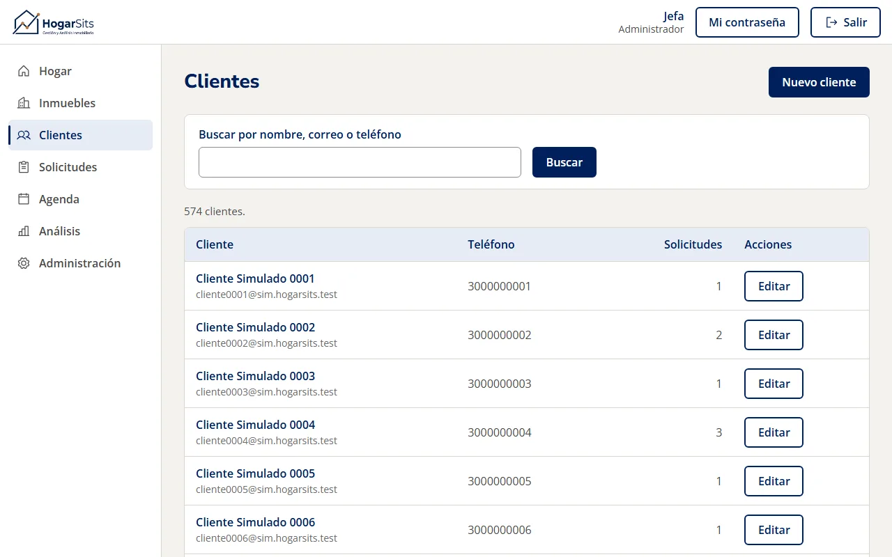

1. Antes de atender a alguien, **búsquelo** por nombre, correo o teléfono (los espacios del teléfono no importan).
2. Si no existe, pulse **Nuevo cliente** y escriba nombre, correo y teléfono.
3. **El correo es único.** Si ya existe, el sistema se lo dice («Ya existe un cliente con este correo») y no crea un duplicado.

---

## 5. Atender a un cliente: de la llegada al cierre

Es el flujo principal. Cada paso deja un registro con fecha y hora.

### Paso 1 · Registrar la llegada
**Solicitudes → Nueva solicitud.** Elija el cliente, el tipo de interés (compra o alquiler), un inmueble de interés (opcional) y el presupuesto (opcional). Pulse **Registrar llegada**.

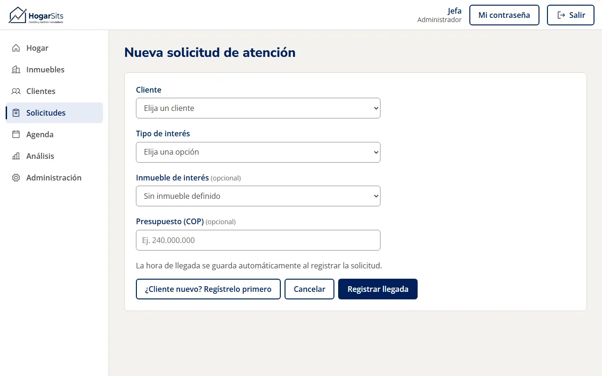

La **hora de llegada se guarda sola** y no se puede cambiar: de ahí salen las estadísticas de demanda. Si el cliente es nuevo, use **¿Cliente nuevo? Regístrelo primero**.

### Paso 2 · La cola
La cola muestra los clientes por orden de llegada, con su estado: **En espera**, **En atención**, **Finalizado** o **Cancelado**.

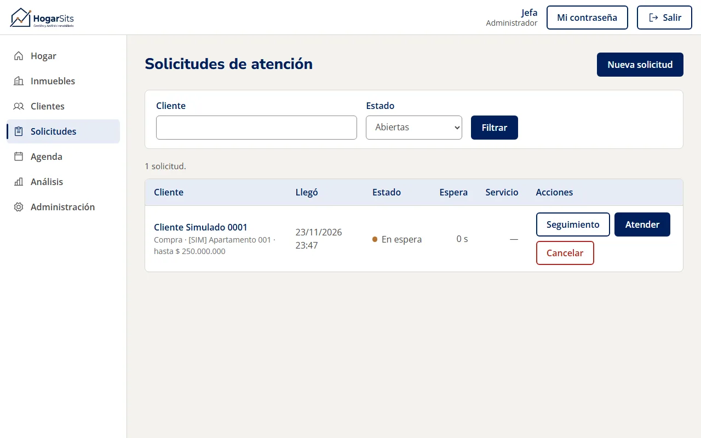

### Paso 3 · Tomar la solicitud
Abra la solicitud y pulse **Tomar**: queda **asignada a usted** y pasa a **En atención**. Una solicitud tiene un solo asesor responsable a la vez.

### Paso 4 · Registrar el seguimiento
En el detalle, la sección **Registrar seguimiento** permite anotar el resultado de cada contacto:

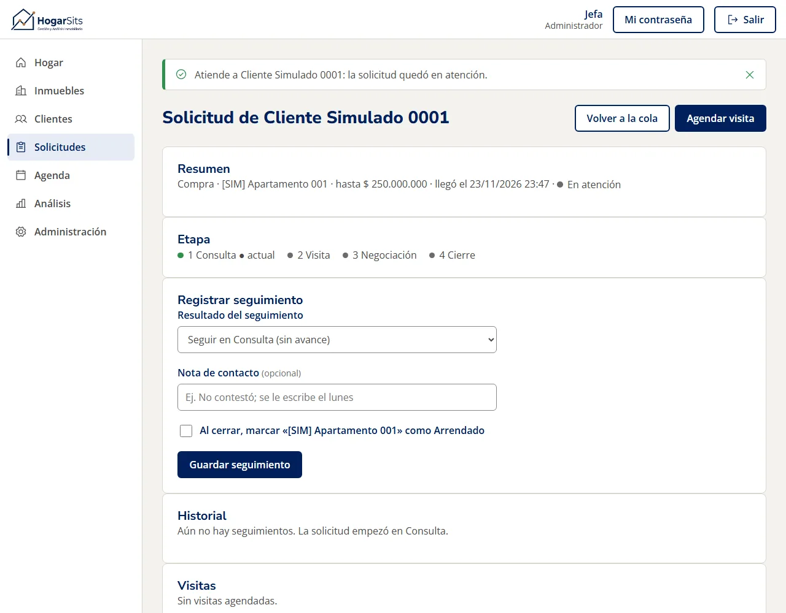

Las etapas son **Consulta → Visita → Negociación → Cierre**, con **Abandono** como salida desde cualquiera. Reglas:
- Se avanza **una etapa a la vez**: no se salta de Consulta a Negociación ni se retrocede.
- **Seguir en la misma etapa** («sin avance») también se registra: cuenta como un seguimiento.
- **Cierre** y **Abandono** son finales: la solicitud ya no admite cambios.
- Al registrar un **Cierre** puede marcar la casilla para pasar el inmueble a **Vendido** o **Arrendado**.
- Agregue una **nota de contacto** si ayuda a recordar («No contestó; se le escribe el lunes»).

### Paso 5 · Finalizar o cancelar
- **Finalizar** cuando termina la atención. Se guardan las horas de inicio y de fin.
- **Cancelar** si el cliente se fue antes de ser atendido. Una solicitud cancelada **no cuenta** en las estadísticas de tiempo de atención.

---

## 6. Agenda de visitas

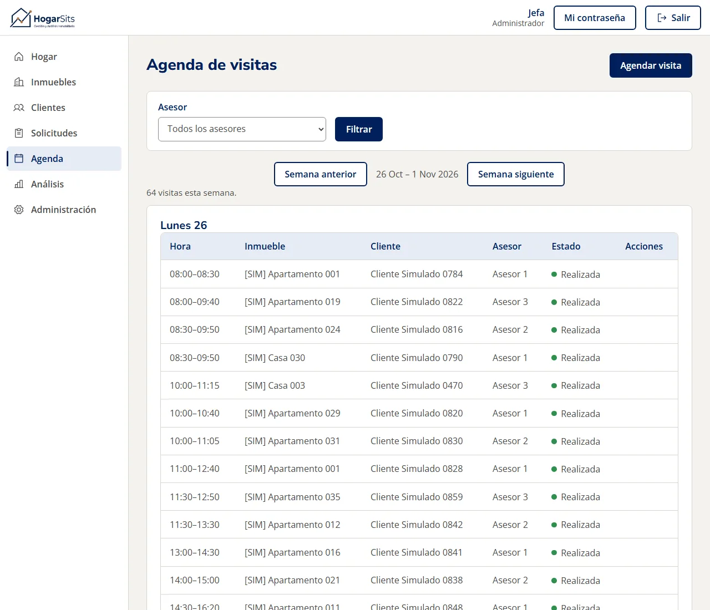

La agenda muestra una semana, agrupada por día. Use **Semana anterior / siguiente** y el filtro **Asesor**.

### Agendar una visita
Desde una solicitud abierta pulse **Agendar visita** (o use **Agendar visita** en la agenda). Elija solicitud, inmueble, asesor, fecha y hora de inicio, y duración.

**El sistema impide los cruces.** Si el asesor ya tiene una visita en ese horario, o el inmueble ya está ocupado, no se guarda y le dice con cuál se cruza:

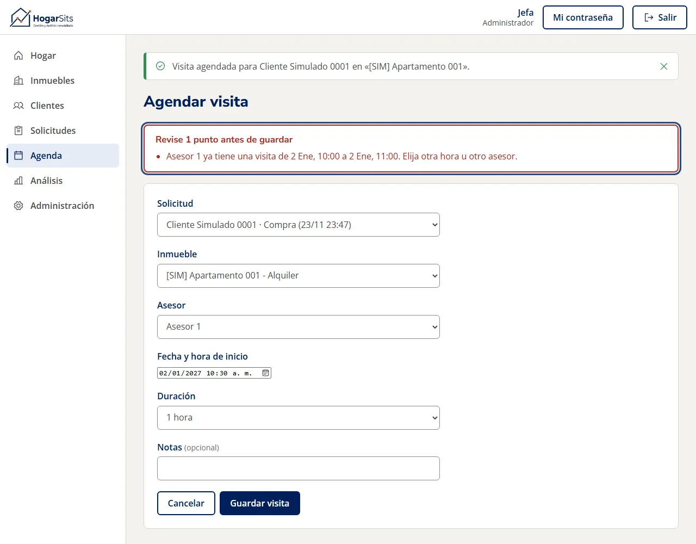

Una visita que **termina justo cuando empieza otra** no es un cruce. Una visita cancelada libera el horario.

### Cambiar una visita
- **Reprogramar:** la visita original queda como *cancelada* y se crea una nueva *programada*.
- **Cancelar:** libera el horario.
- **Marcar realizada:** solo las visitas que ya empezaron. Después de una visita realizada suele corresponder pasar la solicitud a la etapa **Visita**.

---

## 7. Solo administradores

### Usuarios
**Administración → Usuarios.** Cree usuarios nuevos (usuario, nombre, correo, contraseña y **rol**), edite datos, **restablezca la clave** o **desactive** a quien ya no trabaja allí. Un usuario desactivado no puede entrar, pero su historial se conserva.

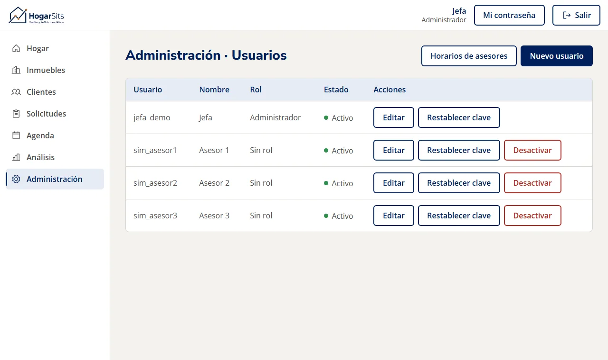

### Horarios de los asesores
Cada asesor tiene turnos por día de la semana. El sistema usa ese horario para saber **cuántos asesores hay disponibles** en cada hora.

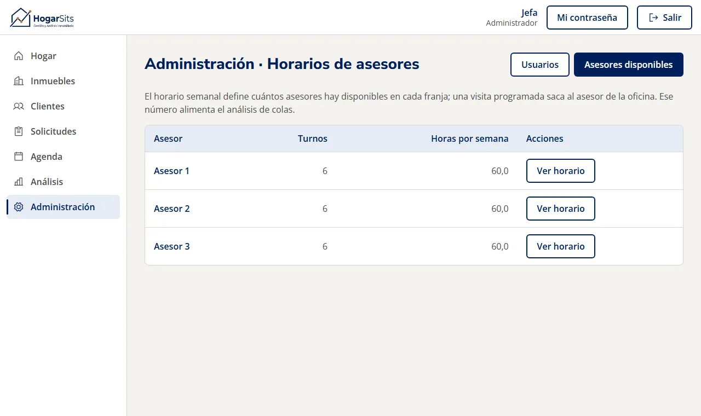

**Asesores disponibles** muestra, por franja de una hora, cuántos tienen turno, cuántos están **en visita** y cuántos quedan **disponibles**. Un asesor en visita **no cuenta** como disponible.

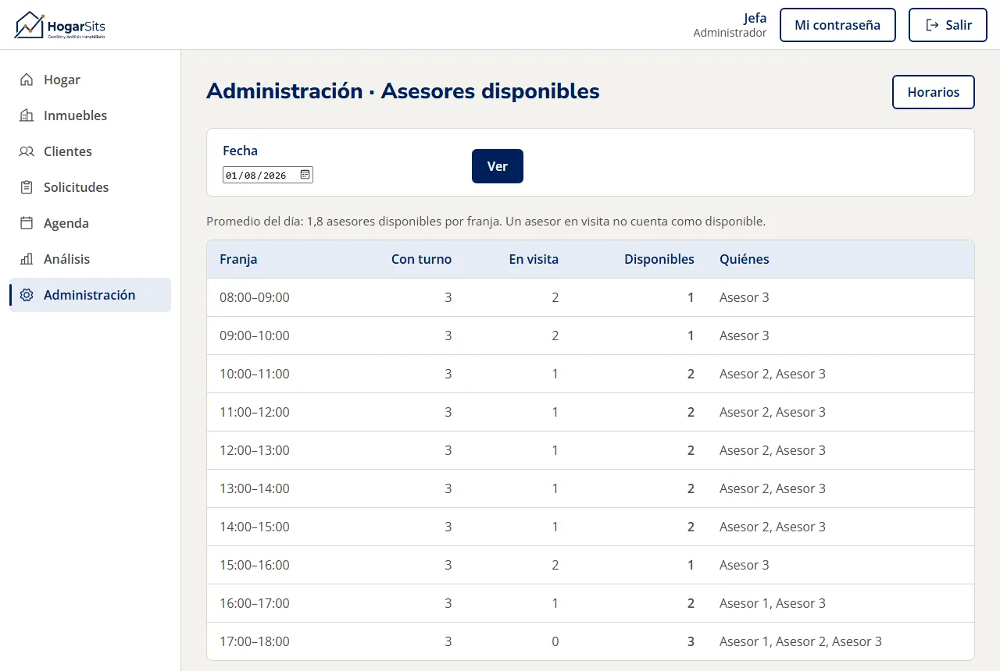

### Análisis
**Análisis** convierte los registros en tres respuestas. Elija el rango de fechas y la **espera máxima aceptable** (por defecto 20 minutos).

1. **¿Cuándo llegan los clientes?** Promedio de llegadas por hora. Las **barras claras** tienen pocos datos (menos de 30 llegadas) y **no son confiables**.

   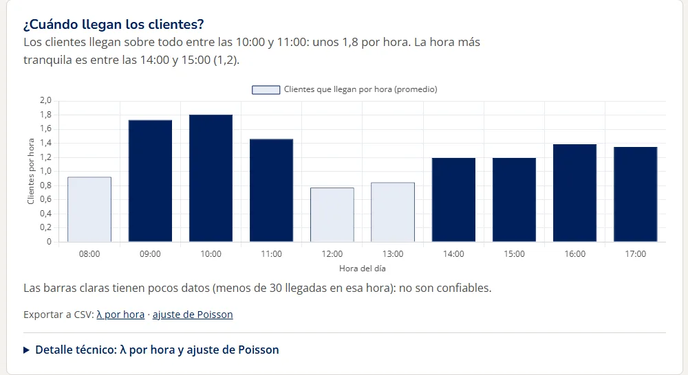

2. **¿Cuántos asesores necesito?** Cuánto espera en promedio un cliente según cuántos asesores haya, y el mínimo de asesores para no pasar de la espera aceptable.

   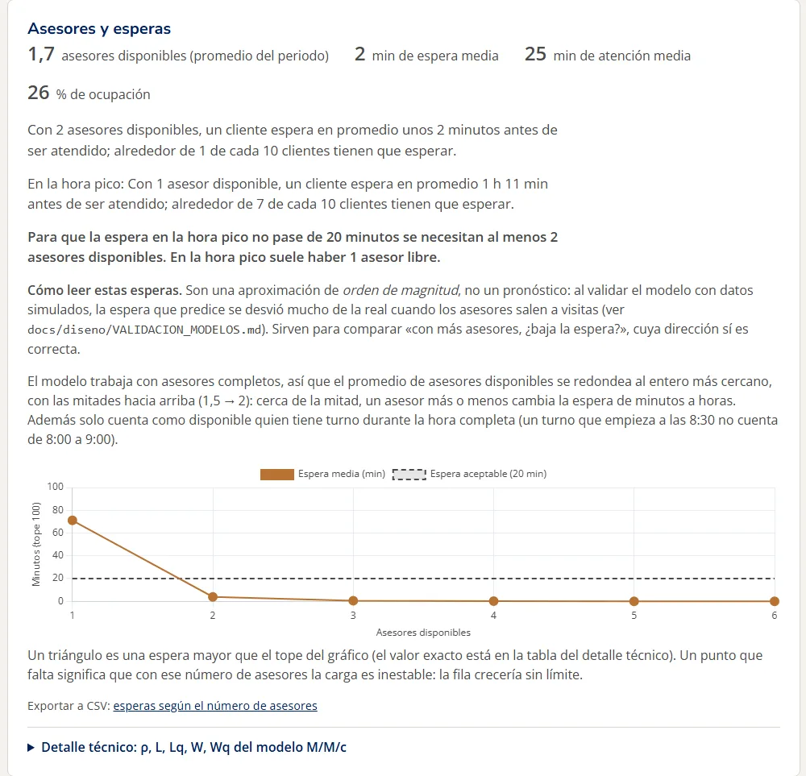

   > **Cómo leerlo:** son aproximaciones de *orden de magnitud*, no pronósticos. Sirven para comparar («con un asesor más, ¿baja la espera?»), cuya dirección sí es correcta, pero no para prometer minutos exactos. Las visitas sacan a los asesores de la oficina y el modelo no lo captura del todo.

3. **¿Cuántos clientes terminan cerrando?** Probabilidad de cerrar o abandonar según la etapa y cuántos seguimientos hacen falta en promedio.

   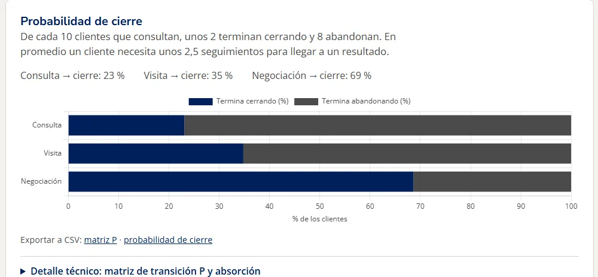

Cada bloque tiene un **Detalle técnico** plegable y un enlace **Exportar a CSV**. Si los datos son pocos, el panel lo avisa; si hay datos simulados en el periodo, también.

### Indicadores por asesor
Solicitudes atendidas, visitas realizadas, cierres y tiempo de atención medio, por asesor y para el equipo. Se exporta a CSV.

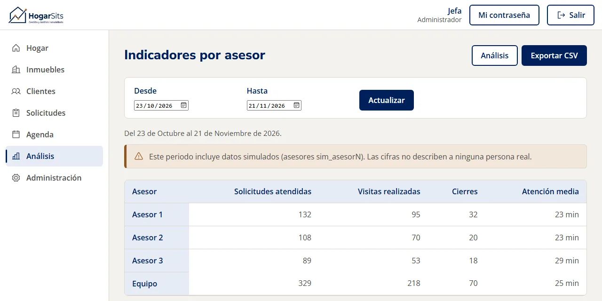

---

## 8. Mensajes frecuentes y qué hacer

| Mensaje | Qué significa | Qué hacer |
|---|---|---|
| «Usuario o contraseña incorrectos» | Datos de acceso erróneos | Revíselos; tras 5 fallos hay 15 min de espera. Pida restablecer la clave. |
| «Ya existe un cliente con este correo» | El cliente ya está registrado | Búsquelo en **Clientes** y use ese registro. |
| «… ya tiene una visita de … a …. Elija otra hora u otro asesor» | Cruce de agenda | Elija otro horario u otro asesor. |
| «Esta solicitud ya no admite cambios de etapa» | Está en Cierre o Abandono | No hay acción: son etapas finales. |
| Un inmueble no aparece al agendar o al crear una solicitud | Está Vendido, Arrendado o inactivo | Revise su estado en **Inmuebles**. |
| Acceso denegado | Pantalla solo para administradores | Pídasela al administrador. |

---

## 9. Lo que HogarSits no hace (todavía)

Para que no espere algo que no existe:
- **No** tiene aplicación móvil, pagos, contratos, publicación en portales ni acceso para clientes finales.
- **No** se integra con WhatsApp: el seguimiento se registra a mano.
- **El historial de etapas aún no es inmutable:** hoy un administrador con acceso técnico podría editarlo (está documentado como defecto conocido, regla RN-33).
- Las cifras del Análisis dependen de la cantidad de datos: con pocos días, desconfíe de las barras claras y de las probabilidades.
- El sistema es un **prototipo académico**; no se ha usado todavía con una inmobiliaria real.

Referencias técnicas: `docs/requerimientos/CASOS_DE_USO.md` (flujos y reglas), `docs/pruebas/INFORME_DE_PRUEBAS.md` (qué se probó y qué no).
