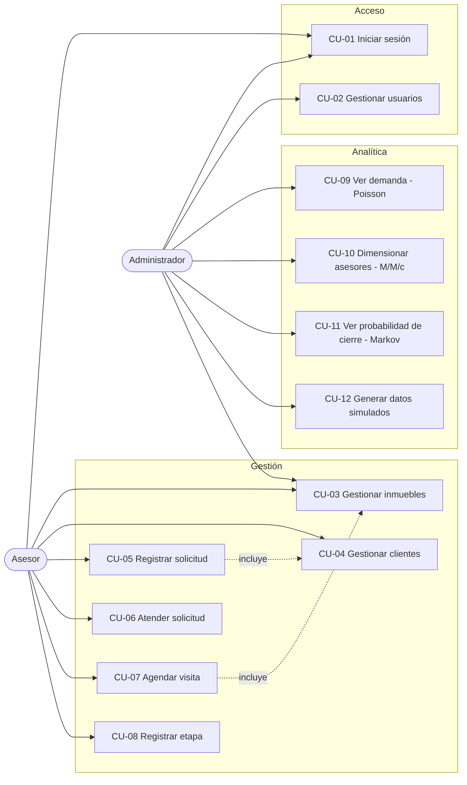
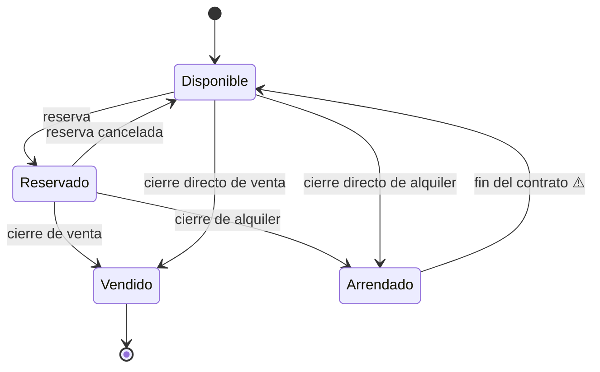
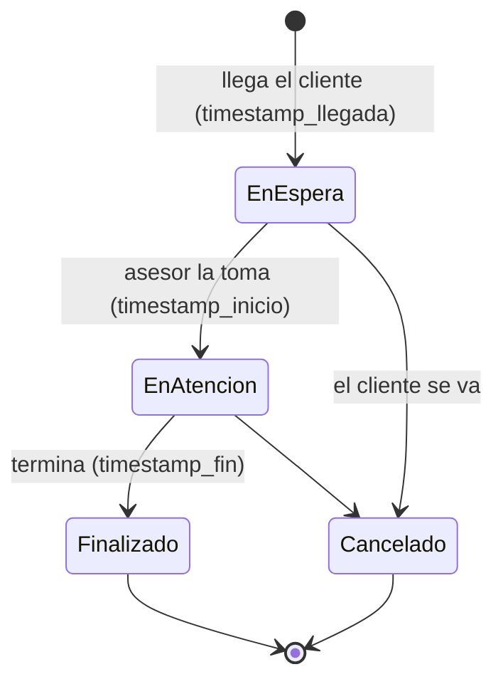
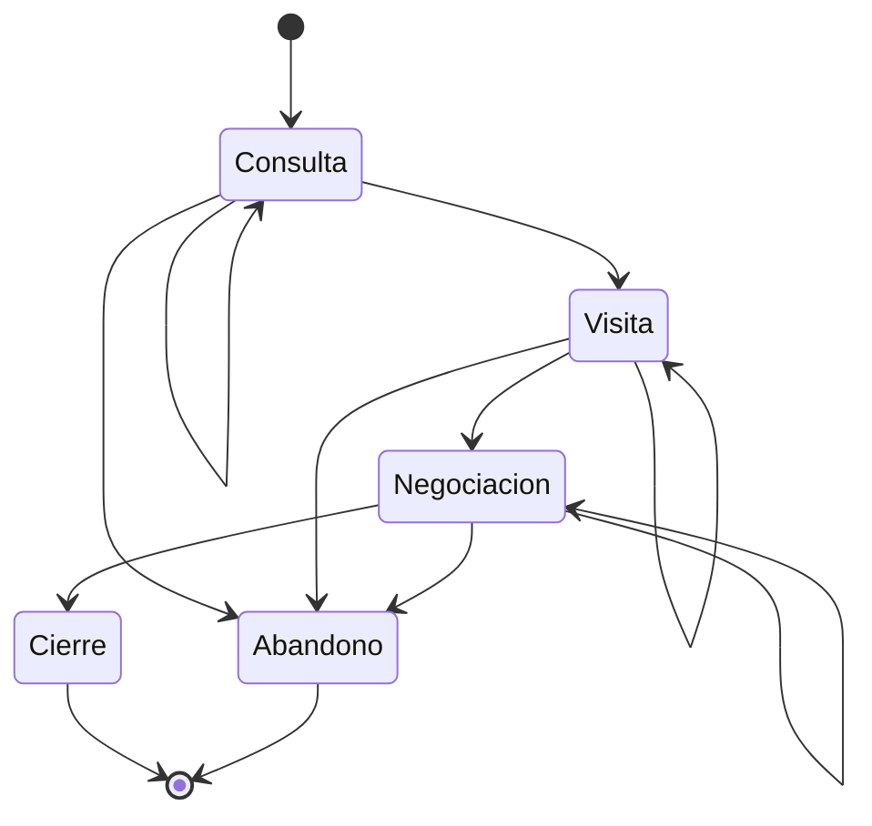

# HogarSits — Casos de uso y reglas de negocio

**Versión:** 0.1 (borrador) · **Fecha:** 2026-11-03 · **Sprint:** 1 · **Issue:** #9
Complementa a [`REQUERIMIENTOS.md`](REQUERIMIENTOS.md) (IDs RF/RNF/HU). Los diagramas usan Mermaid y se ven directamente en GitHub.

---

## 1. Diagrama de casos de uso

El **cliente** no interactúa con el sistema: es un dato que registra el asesor.

| Caso de uso | Actor | Requerimientos | Sprint |
|---|---|---|---|
| CU-01 Iniciar sesión | Admin, Asesor | RF-01, RF-03 | 3 |
| CU-02 Gestionar usuarios | Admin | RF-02 | 3 |
| CU-03 Gestionar inmuebles | Asesor, Admin | RF-10 a RF-15 | 3–4 |
| CU-04 Gestionar clientes | Asesor | RF-20, RF-21 | 3 |
| CU-05 Registrar solicitud | Asesor | RF-22, RF-24 | 3 |
| CU-06 Atender solicitud | Asesor | RF-23, RF-25 | 3–4 |
| CU-07 Agendar visita | Asesor | RF-30 a RF-34 | 4 |
| CU-08 Registrar etapa | Asesor | RF-40 a RF-43 | 4 |
| CU-09 Ver demanda (Poisson) | Admin | RF-50 | 5 |
| CU-10 Dimensionar asesores (M/M/c) | Admin | RF-51 a RF-53 | 5 |
| CU-11 Ver probabilidad de cierre (Markov) | Admin | RF-54, RF-55 | 5 |
| CU-12 Generar datos simulados | Admin / analista | RF-60 | 2 |

---

## 2. Especificación de los casos de uso principales

### CU-05 Registrar solicitud de atención
- **Actor:** Asesor · **Precondición:** sesión iniciada.
- **Flujo principal:**
  1. El asesor busca al cliente por correo o teléfono.
  2. Si existe, lo selecciona; si no, lo crea (CU-04).
  3. Indica el tipo de interés (compra/alquiler), el presupuesto y, opcionalmente, el inmueble de interés.
  4. El sistema crea la solicitud en estado **En espera**, guarda automáticamente la **hora de llegada** y sugiere una etapa inicial **Consulta**.
- **Flujos alternos:**
  - 2a. Correo ya existente → el sistema muestra el cliente existente y no crea un duplicado (RN-10).
  - 3a. El inmueble elegido está Vendido o Arrendado → el sistema lo rechaza (RN-03).
- **Postcondición:** existe una solicitud con `timestamp_llegada` registrado.

### CU-06 Atender solicitud
- **Actor:** Asesor · **Precondición:** solicitud En espera.
- **Flujo principal:**
  1. El asesor toma la solicitud; el sistema la asigna a él, la pasa a **En atención** y guarda la hora de inicio.
  2. Al terminar, el asesor la marca **Finalizado**; el sistema guarda la hora de fin.
- **Alternos:** 1a. Cliente se va antes de ser atendido → **Cancelado** (no cuenta para μ). 2a. Hora de fin < hora de inicio → error (RN-20).
- **Postcondición:** quedan registrados tiempo de espera (inicio − llegada) y tiempo de servicio (fin − inicio).

### CU-07 Agendar visita
- **Actor:** Asesor · **Precondición:** solicitud abierta e inmueble Disponible o Reservado por ese mismo cliente.
- **Flujo principal:**
  1. El asesor elige solicitud, inmueble, asesor, fecha, hora de inicio y duración.
  2. El sistema valida que no haya cruce del asesor (RN-01) ni del inmueble (RN-02).
  3. Guarda la visita en estado **Programada**.
- **Alternos:** 2a. Hay cruce → el sistema muestra el horario en conflicto y no guarda. 2b. Inmueble Vendido/Arrendado → rechazo (RN-03). 3a. Reprogramar/cancelar: la visita cancelada libera el horario (RN-04).
- **Postcondición:** visita programada sin solapamientos; al realizarse, puede proponerse la transición a **Visita** (CU-08).

### CU-08 Registrar cambio de etapa
- **Actor:** Asesor · **Precondición:** solicitud en etapa 1, 2 o 3.
- **Flujo principal:** el asesor elige la nueva etapa; el sistema valida la transición permitida (RN-30), guarda origen, destino y fecha/hora, y actualiza la etapa actual.
- **Alternos:** destino no permitido → error; destino **Cierre** → el sistema propone actualizar el estado del inmueble (RN-05); solicitud en Cierre/Abandono → no admite cambios (RN-31).

### CU-09 / CU-10 / CU-11 Consultar analítica
- **Actor:** Administrador · **Precondición:** datos suficientes (RN-40).
- **Flujo principal:** el administrador elige un rango de fechas; el sistema calcula y muestra λ por franja (CU-09), ρ/L/Lq/W/Wq y c recomendado (CU-10), y la matriz P con probabilidades de absorción y pasos esperados (CU-11).
- **Alternos:** pocos datos → advertencia y resultados marcados como no confiables; ρ ≥ 1 → advertencia de sistema inestable.

---

## 3. Máquinas de estado

### 3.1 Inmueble

### 3.2 Solicitud de atención (cola)

### 3.3 Etapa comercial (cadena de Markov)

Las transiciones permitidas coinciden con los ceros de la matriz P del README: no se salta de Consulta a Negociación o Cierre, ni se retrocede.

### 3.4 Visita
`Programada → Realizada` · `Programada → Cancelada` · `Programada → Reprogramada (nueva Programada)`. Solo **Programada** ocupa el horario.

---

## 4. Reglas de negocio

### Agenda
| ID | Regla |
|---|---|
| RN-01 | Un asesor no puede tener dos visitas **Programadas** que se solapen. Dos intervalos se solapan si `inicio₁ < fin₂` **y** `inicio₂ < fin₁`; que una termine justo cuando empieza la otra **no** es solapamiento. |
| RN-02 | Un inmueble no puede tener dos visitas Programadas que se solapen (misma fórmula). ⚠️ Visitas grupales por validar. |
| RN-03 | No se puede crear una solicitud ni una visita sobre un inmueble **Vendido** o **Arrendado**. |
| RN-04 | Las visitas Canceladas o Reprogramadas liberan el horario. |
| RN-05 | Al registrar un **Cierre**, se propone pasar el inmueble a Vendido (si es venta) o Arrendado (si es alquiler). |
| RN-06 | Las visitas se programan en el futuro; solo se marcan Realizadas las que ya empezaron. |

### Clientes y solicitudes
| ID | Regla |
|---|---|
| RN-10 | El correo del cliente es único. Un mismo cliente puede tener varias solicitudes. ⚠️ Revisar unicidad por teléfono. |
| RN-11 | La hora de llegada la fija el sistema al crear la solicitud; no es editable por el asesor (garantiza datos fiables para λ). |
| RN-12 | Una solicitud tiene un único asesor responsable a la vez. |
| RN-13 | Una solicitud sin movimiento por más de N días se marca "sin seguimiento". ⚠️ N por validar. |

### Tiempos de atención
| ID | Regla |
|---|---|
| RN-20 | `llegada ≤ inicio ≤ fin`. Si no se cumple, no se guarda. |
| RN-21 | Tiempo de espera = `inicio − llegada`; tiempo de servicio = `fin − inicio`. |
| RN-22 | Solo las solicitudes **Finalizadas** con ambos tiempos aportan a la estimación de μ; las **Canceladas** se excluyen. |

### Etapas (Markov)
| ID | Regla |
|---|---|
| RN-30 | Transiciones válidas: Consulta→{Consulta, Visita, Abandono}; Visita→{Visita, Negociación, Abandono}; Negociación→{Negociación, Cierre, Abandono}. |
| RN-31 | Cierre y Abandono son **absorbentes**: no admiten más transiciones. |
| RN-32 | Toda solicitud nace en **Consulta**. |
| RN-33 | Cada transición guarda origen, destino, fecha y hora; el historial no se borra ni edita. |

### Analítica
| ID | Regla |
|---|---|
| RN-40 | Se exige un mínimo de observaciones para estimar (valor por definir en Sprint 5, p. ej. ≥ 30 llegadas por franja y ≥ 30 transiciones por estado de origen). ⚠️ |
| RN-41 | La cola M/M/c solo es estable si ρ = λ/(cμ) < 1; si no, se advierte en vez de mostrar L, Lq, W, Wq. |
| RN-42 | Las franjas horarias se calculan en hora local de Bogotá. |
| RN-43 | Las filas de P deben sumar 1; si un estado de origen no tiene observaciones, se informa y no se inventa la fila. |

---

## 5. Decisiones abiertas para el Sprint 2 (diseño)

1. **Autotransiciones.** La matriz del README tiene probabilidad de permanecer en una etapa (p. ej. Consulta→Consulta = 0,20). Para estimarla hay que decidir cuándo "cuenta" un paso sin cambio de etapa: ¿un seguimiento registrado sin avanzar, o una observación periódica (diaria)? Esto define cómo se guarda `SeguimientoEtapa`.
2. **Asesores disponibles (c).** Falta un modelo de turnos/disponibilidad para saber cuántos asesores atendían en cada franja.
3. **Visita vs. solicitud.** Confirmar si una solicitud puede tener varias visitas (se asume que sí) y si la primera visita realizada dispara la transición a la etapa Visita.
4. **Retorno de Arrendado a Disponible** y la reserva con vencimiento (¿cuánto dura una reserva?).
5. **Estado actual de la solicitud:** ¿se guarda en un campo o se deduce de la última transición?

Estas decisiones se resolverán con la inmobiliaria (encuesta #10) y se documentarán en un ADR.
